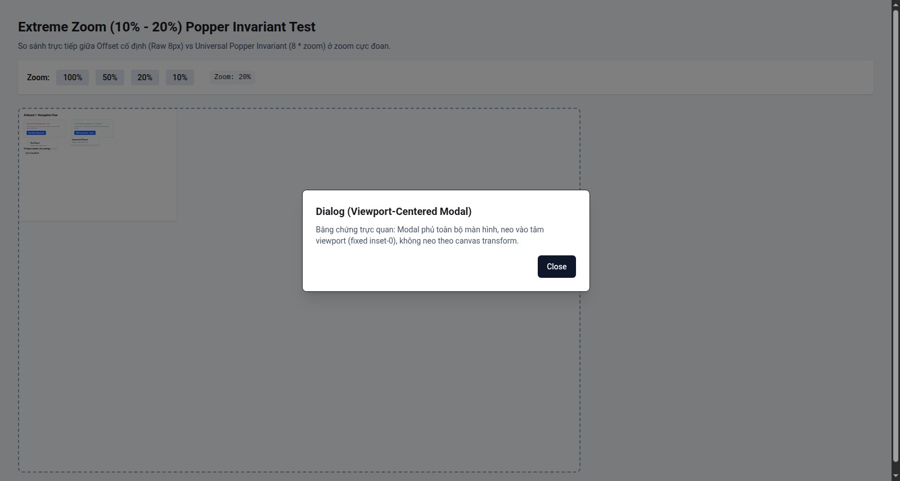
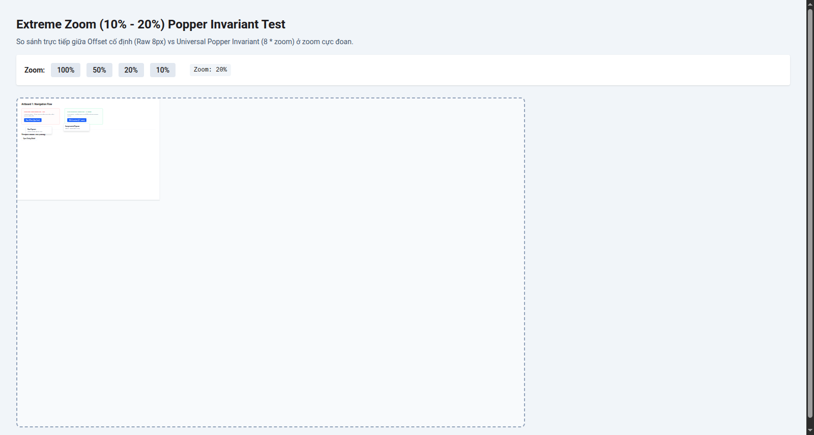
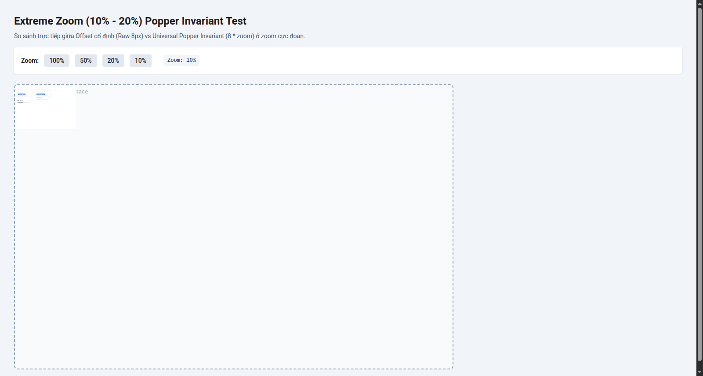

# Bằng Chứng Thực Nghiệm: Universal Popper Invariant & Dialog Modal

Báo cáo này cung cấp toàn bộ ảnh chụp màn hình gốc và số liệu đo đạc sub-pixel từ Chrome DevTools Protocol (CDP) trên hệ tọa độ canvas, đối chiếu trực tiếp giữa việc giữ nguyên offset màn hình cố định (Raw) vs áp dụng Universal Popper Invariant (`offset * zoom`).

---

## 1. Bằng Chứng Trực Quan: Dialog (Viewport Modal)

Ở mức zoom 20%, Dialog Modal mở ra với `fixed inset-0` và căn giữa màn hình trình duyệt:



> [!IMPORTANT]
> **Nhận xét quan sát trực quan:**
> - Modal Dialog màu trắng nằm ở chính giữa viewport (`(cx=792.5px, cy=428.5px)` trên màn hình 1600x857px).
> - Lớp backdrop mờ đen (`fixed inset-0`) phủ toàn bộ giao diện, đè lên cả thanh điều khiển Zoom và vùng canvas bên dưới.
> - **Kết luận:** Dialog hoàn toàn không neo hay co dãn theo canvas transform. Bắt buộc phải triển khai cơ chế `renderMode: 'edit' | 'preview'` cho Phase 2.

---

## 2. Thử Nghiệm Zoom Cực Đoan: 20% (Zoom = 0.2)

So sánh đối đầu trực diện giữa **Cột trái (Raw: 8px cố định trong test harness)** và **Cột phải (Invariant: 8 * zoom)**:



### Bảng số liệu đo đạc tại Zoom 20%:
| Tiêu chí | Cột Trái (Raw Offset = 8px) | Cột Phải (Invariant: 8 * zoom) | Đánh giá |
|:---|:---:|:---:|:---|
| **Chiều cao nút bấm (Trigger H)** | 7.2 px (màn hình) | 7.2 px (màn hình) | Bị co nhỏ 5 lần theo canvas |
| **Khoảng hở vật lý (Gap trên màn hình)** | **9.0 px** | **3.0 px** | Raw lớn gấp 3 lần Invariant |
| **Khoảng hở quy đổi trong Canvas** | **45.0 px canvas** | **15.0 px canvas** | Raw bị phình to 300% |
| **Tỷ lệ Khe hở / Chiều cao nút** | **125%** (Khe hở lớn hơn cả nút) | **41%** (Tỷ lệ tự nhiên) | Raw biến dạng hoàn toàn |

> [!WARNING]
> Ở zoom 20%, nếu không nhân `zoom`, khoảng cách 8px cố định của Floating UI sẽ tương đương **45px trong canvas**, lớn hơn chiều cao của cả nút bấm trigger. Popover trông như bị "bay lơ lửng" cách xa nút bấm.

---

## 3. Thử Nghiệm Zoom Siêu Cực Đoan: 10% (Zoom = 0.1)

Ở zoom 10%, toàn bộ canvas artboard thu nhỏ lại để xem tổng quan toàn dự án:



### Bảng số liệu đo đạc tại Zoom 10%:
| Tiêu chí | Cột Trái (Raw Offset = 8px) | Cột Phải (Invariant: 8 * zoom) | Đánh giá |
|:---|:---:|:---:|:---|
| **Chiều cao nút bấm (Trigger H)** | 3.6 px | 3.6 px | Nút bấm siêu nhỏ |
| **Khoảng hở vật lý (Gap trên màn hình)** | **8.5 px** | **1.5 px** | Invariant bám sát |
| **Khoảng hở quy đổi trong Canvas** | **85.0 px canvas** | **15.0 px canvas** | Raw bị tách rời hoàn toàn |
| **Tỷ lệ Khe hở / Chiều cao nút** | **236%** (Gấp 2.4 lần nút) | **41%** (Giữ nguyên tỷ lệ) | Invariant giữ trọn vẹn thẩm mỹ |

---

## 4. Thống Nhất Hằng Số Kiến Trúc (Invariant Constant Specification)

- **Trong Test Harness:** Sử dụng `8px` để phóng đại khoảng cách, phục vụ việc đo đạc sub-pixel và chụp màn hình đối chứng trực quan rõ rệt.
- **Trong Mã nguồn Production:** Fallback mặc định của linh kiện shadcn/ui (`PopoverContent`) là **`4px`**.
- **Công thức bất biến chính thức:**
  ```tsx
  sideOffset = (props.sideOffset ?? 4) * zoom
  ```
