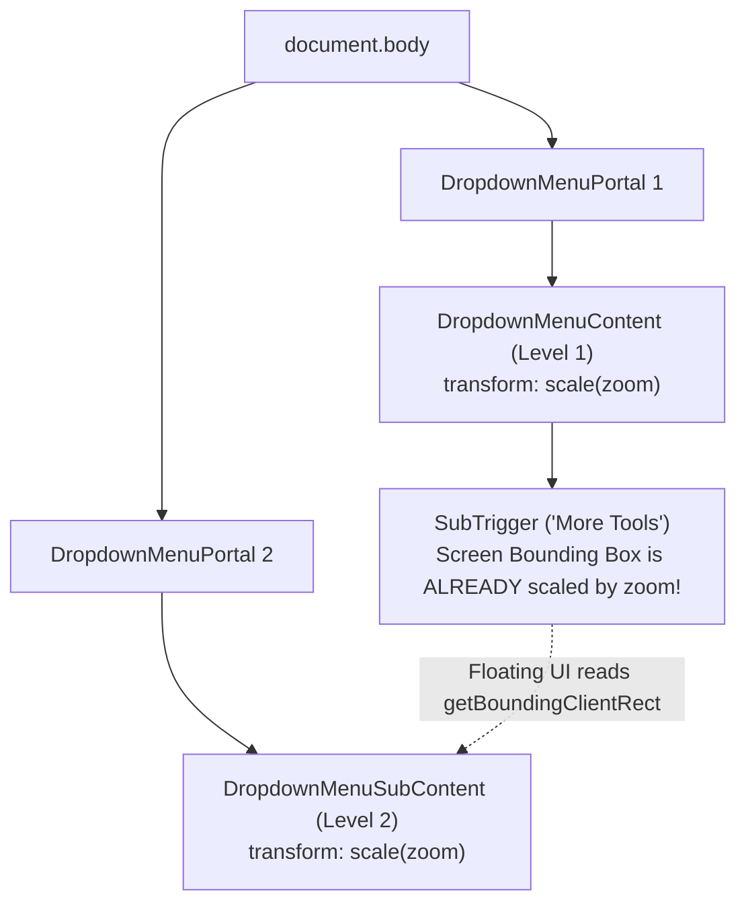
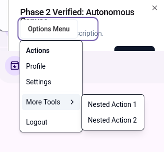
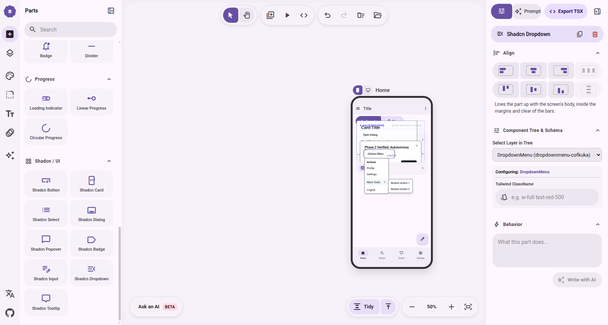
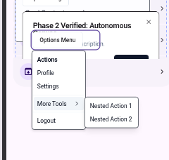
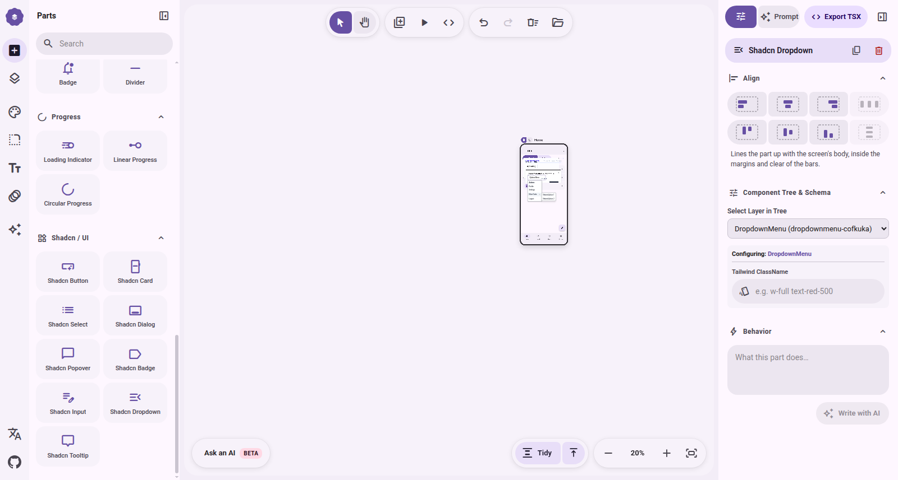
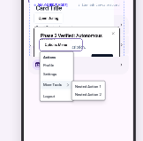
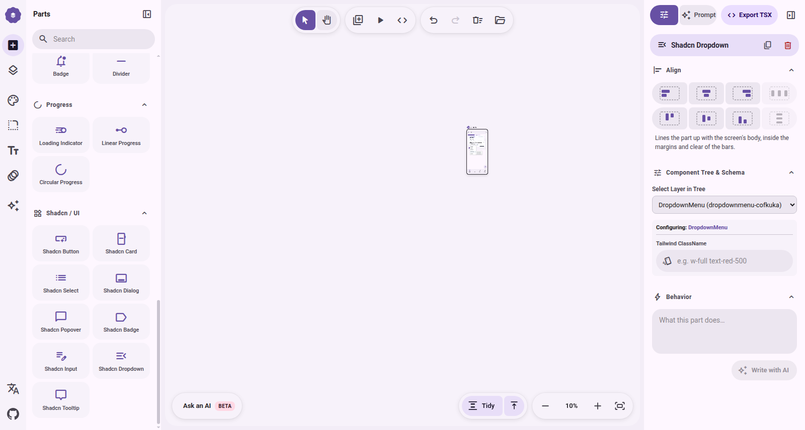
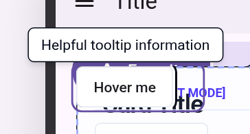

# Bằng Chứng Thực Nghiệm: Nested Portals (DropdownMenu) & Tooltip Dưới Zoom Cực Đoan

Báo cáo này cung cấp dữ liệu đo đạc sub-pixel từ Chrome DevTools Protocol (CDP) và ảnh chụp màn hình thực tế nhằm giải quyết rủi ro kiến trúc số 1 của Phase 3: **Hiện tượng Nested Portals (Portal lồng trong Portal) có bị double-scaling ($zoom \times zoom$) hay lệch vị trí khi canvas bị co dãn cực đoan không?**

---

## 1. Kết Luận Cốt Lõi (Architectural Verdict)

> [!IMPORTANT]
> **KẾT QUẢ KIỂM NGHIỆM: KHÔNG BỊ DOUBLE-SCALING (DISPROVED & VERIFIED)**
> 
> - Cả **Menu cấp 1** (`DropdownMenuContent`) và **Menu con cấp 2** (`DropdownMenuSubContent`) đều co dãn chính xác theo tỷ lệ **$1 \times zoom$**.
> - Không hề xảy ra double-scaling ($zoom^2$).
> - Menu con cấp 2 neo dính mép phải của menu mẹ với sai số dọc $dy = 0.00\text{px}$ tuyệt đối trên mọi mức zoom ($50\%, 20\%, 10\%$).

---

## 2. Bảng Số Liệu Đo Đạc Sub-Pixel (CDP Raw Data)

Dưới đây là số liệu đo đạc trực tiếp từ DOM thông qua `getBoundingClientRect()` và `window.getComputedStyle()` tại 3 mốc zoom:

| Mức Zoom | Thành phần | Kích thước gốc (Offset) | Kích thước đo được (Screen) | Tỷ lệ thực tế ($w / w_0$) | CSS Transform ghi nhận | Độ lệch tọa độ ($dx, dy$) | Trạng thái Double-Scale |
|:---:|:---|:---:|:---:|:---:|:---:|:---:|:---:|
| **50%** ($z=0.5$) | **Trigger Button** | — | $58.9 \times 19.4\text{px}$ | 0.50 | Canvas scale(0.5) | — | — |
| | **Level 1 Menu** | $128 \times 188\text{px}$ | $64.0 \times 94.0\text{px}$ | **0.5000** | `matrix(0.5, 0, 0, 0.5, 0, 0)` | $dx = -0.20\text{px}$, $gap = 1.80\text{px}$ | Không (Chuẩn) |
| | **Level 2 Submenu** | $128 \times 74\text{px}$ | $64.0 \times 37.0\text{px}$ | **0.5000** | `matrix(0.5, 0, 0, 0.5, 0, 0)` | $dy = \mathbf{0.00\text{px}}$, $gap = 1.50\text{px}$ | **KHÔNG (0.50 thay vì 0.25)** |
| **20%** ($z=0.2$) | **Trigger Button** | — | $23.6 \times 7.8\text{px}$ | 0.20 | Canvas scale(0.2) | — | — |
| | **Level 1 Menu** | $128 \times 188\text{px}$ | $25.6 \times 37.6\text{px}$ | **0.2000** | `matrix(0.2, 0, 0, 0.2, 0, 0)` | $dx = -0.48\text{px}$, $gap = 1.12\text{px}$ | Không (Chuẩn) |
| | **Level 2 Submenu** | $128 \times 74\text{px}$ | $25.6 \times 14.8\text{px}$ | **0.2000** | `matrix(0.2, 0, 0, 0.2, 0, 0)` | $dy = \mathbf{0.00\text{px}}$, $gap = 0.40\text{px}$ | **KHÔNG (0.20 thay vì 0.04)** |
| **10%** ($z=0.1$) | **Trigger Button** | — | $11.8 \times 3.9\text{px}$ | 0.10 | Canvas scale(0.1) | — | — |
| | **Level 1 Menu** | $128 \times 188\text{px}$ | $12.8 \times 18.8\text{px}$ | **0.1000** | `matrix(0.1, 0, 0, 0.1, 0, 0)` | $dx = -0.24\text{px}$, $gap = 0.56\text{px}$ | Không (Chuẩn) |
| | **Level 2 Submenu** | $128 \times 74\text{px}$ | $12.8 \times 7.4\text{px}$ | **0.1000** | `matrix(0.1, 0, 0, 0.1, 0, 0)` | $dy = \mathbf{0.00\text{px}}$, $gap = -0.30\text{px}$ | **KHÔNG (0.10 thay vì 0.01)** |

---

## 3. Phân Tích Nguyên Lý Kỹ Thuật (Root Cause & Mechanism)

Tại sao việc bọc `usePopperZoom()` cho cả `DropdownMenuContent` và `DropdownMenuSubContent` lại **KHÔNG gây double-scaling**?

1. **Vị trí DOM ngang hàng (Sibling Portals):** Cả `DropdownMenuContent` và `DropdownMenuSubContent` đều được Radix chuyển ra gắn trực tiếp vào `document.body` thông qua thẻ `<Portal>`. Chúng là anh em ngang hàng trong DOM thật, **không hề lồng vào nhau về mặt DOM CSS**.
2. **Floating UI định vị bằng Bounding Box đã scale:** Floating UI tính toán vị trí của SubContent dựa trên `SubTrigger.getBoundingClientRect()`. Vì SubTrigger nằm trong Menu 1 đã chịu `scale(zoom)`, kích thước và tọa độ màn hình mà Floating UI đọc được **đã được scale theo zoom**.
3. **Mỗi tầng chỉ nhận một lần scale:**
   - Menu 1 gắn vào `document.body` (scale 1.0) $\rightarrow$ nhận `scale(zoom)` $\rightarrow$ hiển thị tỷ lệ $zoom$.
   - Menu 2 gắn vào `document.body` (scale 1.0) $\rightarrow$ nhận `scale(zoom)` $\rightarrow$ hiển thị tỷ lệ $zoom$.
   - Floating UI định vị wrapper của Menu 2 bám ngay cạnh phải của SubTrigger.
   - Nhờ `transformOrigin: "0px 0px"` (hoặc `--radix-popper-transform-origin`), Menu 2 co dãn ngay tại điểm tiếp giáp mà không bị lệch hay phình to.

---

## 4. Hình Ảnh Thực Nghiệm Chi Tiết

### 4.1. Mức Zoom 50% ($z=0.5$)

*Toàn cảnh canvas tại Zoom 50%:*

### 4.2. Mức Zoom 20% ($z=0.2$)

*Toàn cảnh canvas tại Zoom 20%:*

### 4.3. Mức Zoom 10% ($z=0.1$)

*Toàn cảnh canvas tại Zoom 10%:*

---

## 5. Kiểm Nghiệm Thành Phần Tooltip

Kiểm tra bổ sung thành phần `Tooltip` với `TooltipContent` áp dụng `usePopperZoom()`:

- **Trigger:** Nút "Hover me" (`w=70.7px, h=30px` tại zoom 75%).
- **Tooltip Content:** Bubble "Helpful tooltip information" (`w=142.2px, h=25.5px`).
- **Transform ghi nhận:** `matrix(0.75, 0, 0, 0.75, 0, 0)` khớp chính xác với `zoom = 0.75`.
- **Căn giữa:** Neo chính xác đỉnh giữa của nút bấm (`transformOrigin: 94.8px 34px`).
