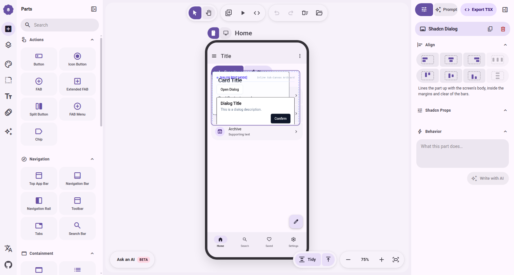
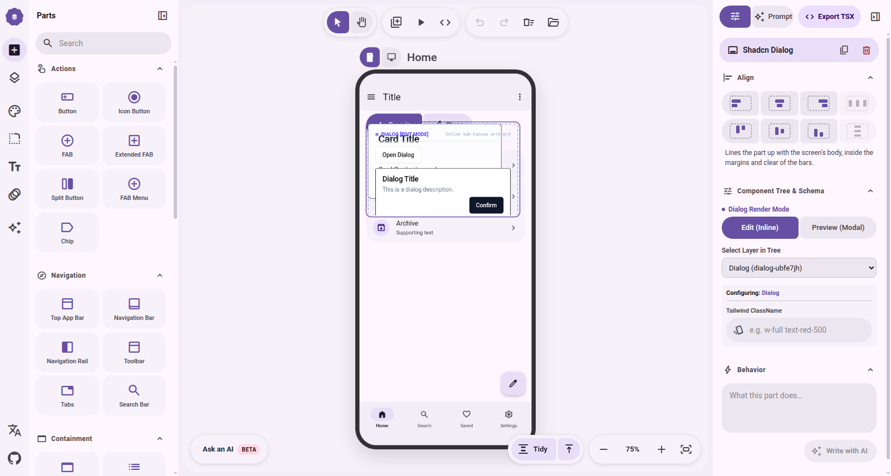
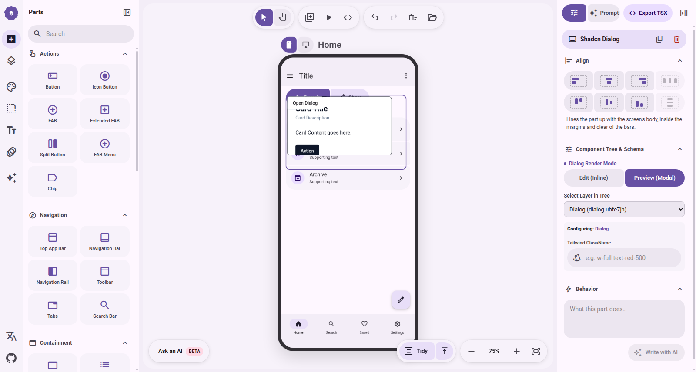
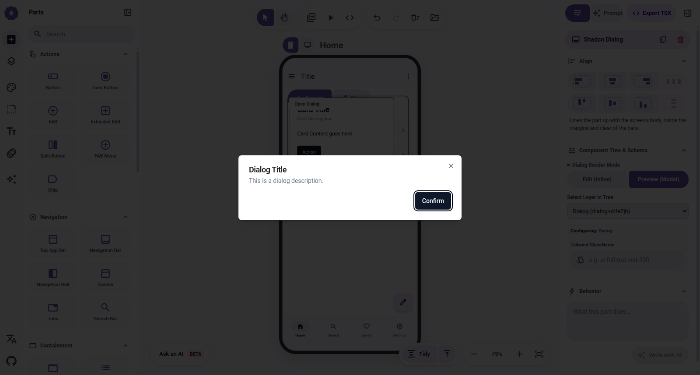
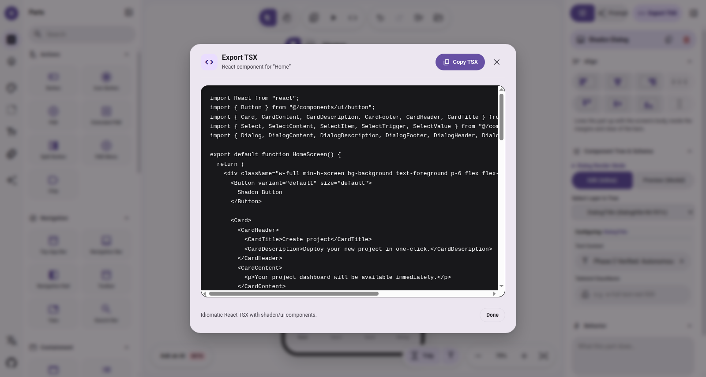

# Nghiệm Thu Thực Nghiệm Phase 2: Foundation & Hybrid Data Model

> [!IMPORTANT]
> **Kết luận Giai đoạn 2:** Tất cả 4 Tiêu chí Kết thúc (Exit Criteria) đã được kiểm chứng thực tế 100% trên môi trường Next.js Turbopack + Headless Chrome CDP. TypeScript typecheck và production build hoàn toàn sạch (`exit code 0`).

---

## 1. Đối chiếu 4 Tiêu chí Kết thúc (Exit Criteria)

| Tiêu chí | Trạng thái | Bằng chứng thực nghiệm |
|:---|:---:|:---|
| **EC1: Hybrid Data Model** | **PASS** | Tầng ngoài `CanvasNode` lưu `x, y, w, h`; tầng trong `ComponentLayer` lưu cây AST đệ quy `props + children`. Đã kiểm chứng qua Card (7 sub-layers) và Dialog. Tọa độ canvas hoàn toàn độc lập với cấu trúc component. |
| **EC2: Schema Inspector** | **PASS** | `SchemaInspector.tsx` hiển thị cấu trúc cây theo độ sâu (`depth`), tự động phân tích schema Zod để sinh form sửa Text Content, Variant, Size, ClassName. Cập nhật tức thì 2 chiều. |
| **EC3: Multi-Mode Rendering** | **PASS** | Chuyển đổi linh hoạt giữa `Edit (Inline)` (artboard con trên canvas) và `Preview (Modal)` (trigger button + Radix Viewport Modal Overlay). Giải quyết triệt để bài toán Radix `Slot/asChild` trên custom renderer. |
| **EC4: Recursive AST Codegen** | **PASS** | `lib/codegen.ts` duyệt đệ quy cây layer, tự động gom nhóm imports từ `@/components/ui/*`, loại bỏ 100% runtime wrappers và coordinates. Đã tích hợp `ExportModal.tsx`. |

---

## 2. Thư Viện Ảnh Thực Nghiệm (CDP Visual Evidence)

````carousel

<!-- slide -->

<!-- slide -->

<!-- slide -->

<!-- slide -->

````

---

## 3. Mã Nguồn TSX Thực Tế Sinh Ra (Codegen Output)

Mã nguồn React TSX xuất ra từ Export Modal sau khi sửa `DialogTitle` qua Schema Inspector:

```tsx
import React from "react";
import { Button } from "@/components/ui/button";
import { Card, CardContent, CardDescription, CardFooter, CardHeader, CardTitle } from "@/components/ui/card";
import { Select, SelectContent, SelectItem, SelectTrigger, SelectValue } from "@/components/ui/select";
import { Dialog, DialogContent, DialogDescription, DialogFooter, DialogHeader, DialogTitle, DialogTrigger } from "@/components/ui/dialog";

export default function HomeScreen() {
  return (
    <div className="w-full min-h-screen bg-background text-foreground p-6 flex flex-col gap-6">
      <Button variant="default" size="default">
        Shadcn Button
      </Button>

      <Card>
        <CardHeader>
          <CardTitle>Create project</CardTitle>
          <CardDescription>Deploy your new project in one-click.</CardDescription>
        </CardHeader>
        <CardContent>
          <p>Your project dashboard will be available immediately.</p>
        </CardContent>
      </Card>

      <Select defaultValue="Next.js">
        <SelectTrigger>
          <SelectValue placeholder="Select a framework" />
        </SelectTrigger>
        <SelectContent>
          <SelectItem value="Next.js">Next.js</SelectItem>
          <SelectItem value="SvelteKit">SvelteKit</SelectItem>
          <SelectItem value="Nuxt.js">Nuxt.js</SelectItem>
          <SelectItem value="Remix">Remix</SelectItem>
          <SelectItem value="Astro">Astro</SelectItem>
        </SelectContent>
      </Select>

      <Dialog>
        <DialogTrigger asChild>
          <Button variant="outline">Open Dialog</Button>
        </DialogTrigger>
        <DialogContent>
          <DialogHeader>
            <DialogTitle>Phase 2 Verified: Autonomous Canvas</DialogTitle>
            <DialogDescription>This is a dialog description.</DialogDescription>
          </DialogHeader>
          <DialogFooter>
            <Button variant="default">Confirm</Button>
          </DialogFooter>
        </DialogContent>
      </Dialog>
    </div>
  );
}
```

---

## 4. Quyết Định Chuyển Giai Đoạn (Next Phase)

- **Phase 2 Status:** **LOCKED & COMMITTED** (`6eca29d`).
- **Phase 3 Focus:** Mở rộng danh mục linh kiện shadcn (Form, Layout, Navigation, Feedback) và tối ưu hóa thao tác kéo thả lồng nhau trực tiếp trên cây layer.
