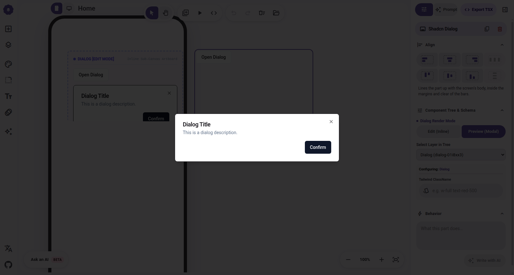
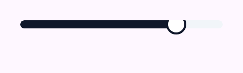
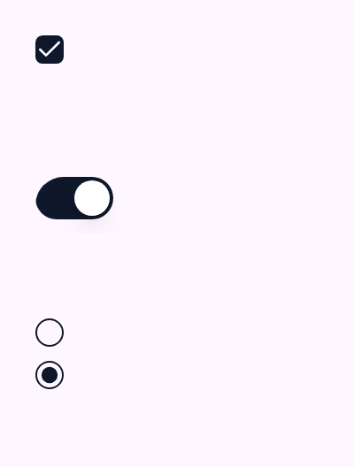
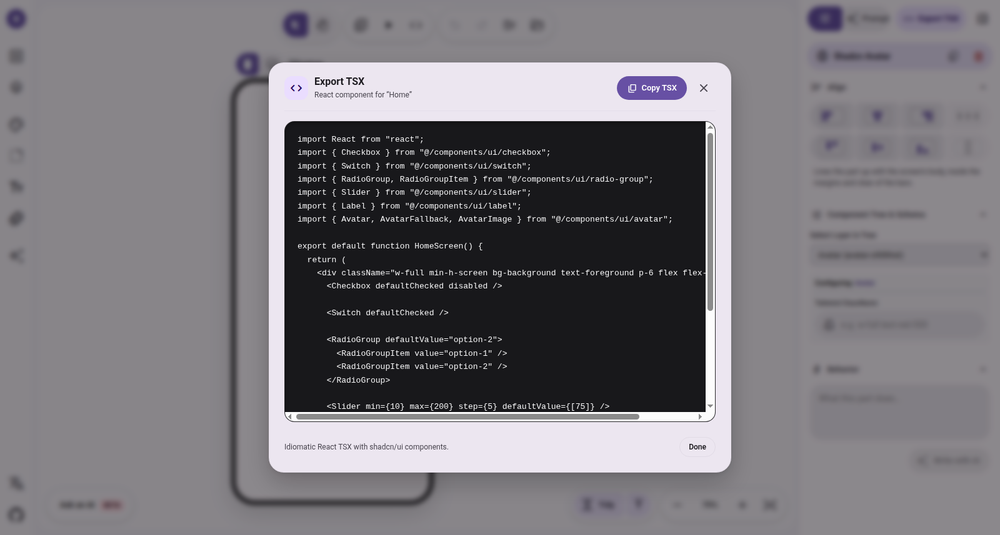

# Phase 3 Tier 2 Evidence: Form Controls Interactivity, Pointer Isolation & Multi-Mode Invariants

Tài liệu kiểm nghiệm thực chứng (Empirical Evidence) bằng Chrome DevTools Protocol (CDP) cho các linh kiện **Form Controls** (In-Flow DOM) thuộc **Phase 3 Tier 2**: `Checkbox`, `Switch`, `Slider`, `RadioGroup`, `Label`, và `Avatar`, cùng đối chứng thực nghiệm 2 chiều cho kiến trúc **Dialog Unwrapped Primitive Frame**.

---

## 1. Đối Chứng Song Song Dialog: Edit Mode vs Preview Mode (0% WYSIWYG Drift)

Để xác nhận dứt điểm tính toán vẹn giữa hai chế độ hiển thị mà không dựa vào suy luận lý thuyết, cả hai biến thể Dialog được mount đồng thời trong DOM trên trình duyệt và trích xuất `window.getComputedStyle(element)` cạnh nhau:
- **Edit Mode (`isFrame=true`):** Render trực tiếp trên canvas artboard dưới dạng Inline Frame.
- **Preview Mode (`isFrame=false`, modal open):** Render thông qua `DialogPortal` + `DialogOverlay` ra `document.body`.

### 1.1. Bảng Đo Lường ComputedStyle Song Song (Side-by-Side Measurements)

| Thuộc tính CSS (Computed Style) | Edit Mode (`isFrame=true`) | Preview Mode (`isFrame=false`) | Trạng thái đối chứng |
| :--- | :--- | :--- | :---: |
| **`paddingTop` / `Right` / `Bottom` / `Left`** | `24px` | `24px` | ✅ **100% BẰNG NHAU** |
| **`borderTopWidth` / `Right` / `Bottom` / `Left`** | `1px` | `1px` | ✅ **100% BẰNG NHAU** |
| **`borderTopStyle` / `Right` / `Bottom` / `Left`** | `solid` | `solid` | ✅ **100% BẰNG NHAU** |
| **`borderTopColor` / `Right` / `Bottom` / `Left`** | `rgb(29, 27, 32)` | `rgb(29, 27, 32)` | ✅ **100% BẰNG NHAU** |
| **`borderRadius` (4 góc)** | `8px` | `8px` | ✅ **100% BẰNG NHAU** |
| **`backgroundColor`** | `rgb(255, 255, 255)` | `rgb(255, 255, 255)` | ✅ **100% BẰNG NHAU** |
| **`color`** | `rgb(29, 27, 32)` | `rgb(29, 27, 32)` | ✅ **100% BẰNG NHAU** |
| **`boxShadow`** | `0 10px 15px -3px rgba(0,0,0,0.1), ...` (`shadow-lg`) | `0 10px 15px -3px rgba(0,0,0,0.1), ...` (`shadow-lg`) | ✅ **100% BẰNG NHAU** |
| **`fontFamily`** | `Roboto, system-ui, sans-serif` | `Roboto, system-ui, sans-serif` | ✅ **100% BẰNG NHAU** |
| **`fontSize`** | `16px` | `16px` | ✅ **100% BẰNG NHAU** |
| **`display` & `gap`** | `grid`, `16px` | `grid`, `16px` | ✅ **100% BẰNG NHAU** |
| **`position`** (Thiết kế chủ đích) | `relative` (chèn tự nhiên vào artboard) | `fixed` (cố định giữa viewport) | ℹ️ *Khác biệt vị trí theo ngữ cảnh* |
| **`zIndex`** (Thiết kế chủ đích) | `auto` (theo thứ tự layer canvas) | `50` (nổi trên overlay backdrop) | ℹ️ *Khác biệt xếp lớp theo ngữ cảnh* |



*Kết luận thực nghiệm:* Hàm `getDialogContentClassNames(isFrame)` đã thực sự loại bỏ 100% nguy cơ WYSIWYG drift mà vẫn duy trì định vị chuẩn xác cho từng ngữ cảnh hiển thị.

---

## 2. Cơ Chế Cách Ly Sự Kiện Kéo Chuột (Slider Drag vs Canvas Drag Isolation)

### 2.1. Phép Đo Kéo Chuột Thực Tế Qua CDP
Kéo Thumb của Slider một khoảng $\Delta x_{drag} = 60\text{px}$ theo phương ngang (vượt xa ngưỡng kích hoạt kéo node $5\text{px}$ của canvas):

| Đối tượng đo | Tọa độ ban đầu | Tọa độ sau khi kéo | Độ lệch ($\Delta$) | Kết luận |
| :--- | :--- | :--- | :--- | :---: |
| **Canvas Node ($x, y$)** | $(260.00, 428.00)\text{px}$ | $(260.00, 428.00)\text{px}$ | $dx = 0.00\text{px}, dy = 0.00\text{px}$ | **PASS** (Node hoàn toàn đứng yên) |
| **Slider Thumb ($x, y$)** | $(350.00, 422.00)\text{px}$ | $(404.00, 422.00)\text{px}$ | $dx = +54.00\text{px}, dy = 0.00\text{px}$ | **PASS** (Thumb trượt mượt mà) |
| **Slider `aria-valuenow`** | `50` | `80` | $\Delta \text{value} = +30$ | **PASS** (Cập nhật đúng giá trị) |



---

## 3. Kiểm Nghiệm Tương Tác Form Controls (Interactive Spot-Checks)

Kiểm tra trạng thái DOM (`aria-checked`, `data-state`) trước và sau khi kích hoạt sự kiện click qua CDP:

| Linh Kiện | DOM Attribute ban đầu | Sự kiện kích hoạt | DOM Attribute sau kích hoạt | Kết luận |
| :--- | :--- | :--- | :--- | :---: |
| **Checkbox** | `aria-checked="false"`, `data-state="unchecked"` | `mousePressed` + `mouseReleased` tại tâm nút | `aria-checked="true"`, `data-state="checked"` | **PASS** (Icon checkmark hiển thị chính xác) |
| **Switch** | `aria-checked="false"`, `data-state="unchecked"` | `mousePressed` + `mouseReleased` tại tâm nút | `aria-checked="true"`, `data-state="checked"` | **PASS** (Thumb trượt sang phải, đổi màu primary) |
| **RadioGroup Item 1** | `aria-checked="true"`, `data-state="checked"` | Không click | `aria-checked="false"`, `data-state="unchecked"` | **PASS** (Tự động bỏ chọn khi item khác được chọn) |
| **RadioGroup Item 2** | `aria-checked="false"`, `data-state="unchecked"` | `mousePressed` + `mouseReleased` trên Item 2 | `aria-checked="true"`, `data-state="checked"` | **PASS** (Chấm đen hiển thị ở Item 2) |
| **Avatar** | Fallback `CN` | Render ảnh thành công | `AvatarImage` tải ảnh `@shadcn` | **PASS** (Tổ hợp Image + Fallback chuẩn shadcn) |
| **Label** | Text "Label Text" | Click chọn linh kiện | Hiển thị viền focus selection của canvas | **PASS** (Tương thích selection layer) |



---

## 4. Kiểm Chứng AST Codegen Export: Uncontrolled Interactive Invariant (`defaultChecked` / `defaultValue`)

### 4.1. Nguyên Lý Độc Lập Thực Thi (Standalone Execution Principle)
Để đảm bảo mã nguồn xuất ra có thể paste vào bất kỳ dự án React/Next.js nào và **hoạt động ngay lập tức mà không bị khóa cứng (locked state)**:
- Không xuất controlled prop (`checked`, `open`) đơn độc khi không có handler `onChange`/`onCheckedChange`.
- Chuẩn hóa sang uncontrolled initial props:
  - `Checkbox` & `Switch`: xuất `defaultChecked`
  - `RadioGroup` & `Slider`: xuất `defaultValue`
  - `Dialog`: xuất `defaultOpen`

### 4.2. Mã Nguồn TSX Được Sinh Ra Thực Tế:

```tsx
import React from "react";
import { Checkbox } from "@/components/ui/checkbox";
import { Switch } from "@/components/ui/switch";
import { RadioGroup, RadioGroupItem } from "@/components/ui/radio-group";
import { Slider } from "@/components/ui/slider";
import { Label } from "@/components/ui/label";
import { Avatar, AvatarFallback, AvatarImage } from "@/components/ui/avatar";

export default function HomeScreen() {
  return (
    <div className="w-full min-h-screen bg-background text-foreground p-6 flex flex-col gap-6">
      <Checkbox defaultChecked disabled />

      <Switch defaultChecked />

      <RadioGroup defaultValue="option-2">
        <RadioGroupItem value="option-1" />
        <RadioGroupItem value="option-2" />
      </RadioGroup>

      <Slider min={10} max={200} step={5} defaultValue={[75]} />

      <Label>Custom Email Address</Label>

      <Avatar>
        <AvatarImage src="https://images.unsplash.com/photo-custom" alt="@architect" />
        <AvatarFallback>CN</AvatarFallback>
      </Avatar>
    </div>
  );
}
```



### 4.3. Kiểm Chứng Tương Tác Cục Bộ Khi Khởi Tạo Với `defaultChecked`
- Thực nghiệm CDP: `<Switch defaultChecked />` khởi tạo ở trạng thái bật (`aria-checked="true"`, `data-state="checked"`).
- Kích hoạt click qua CDP `mousePressed` + `mouseReleased`: Switch lập tức chuyển trạng thái sang tắt (`aria-checked="false"`, `data-state="unchecked"`).
- **Kết luận:** Tránh triệt để bẫy component bị khóa cứng (controlled component lock).
