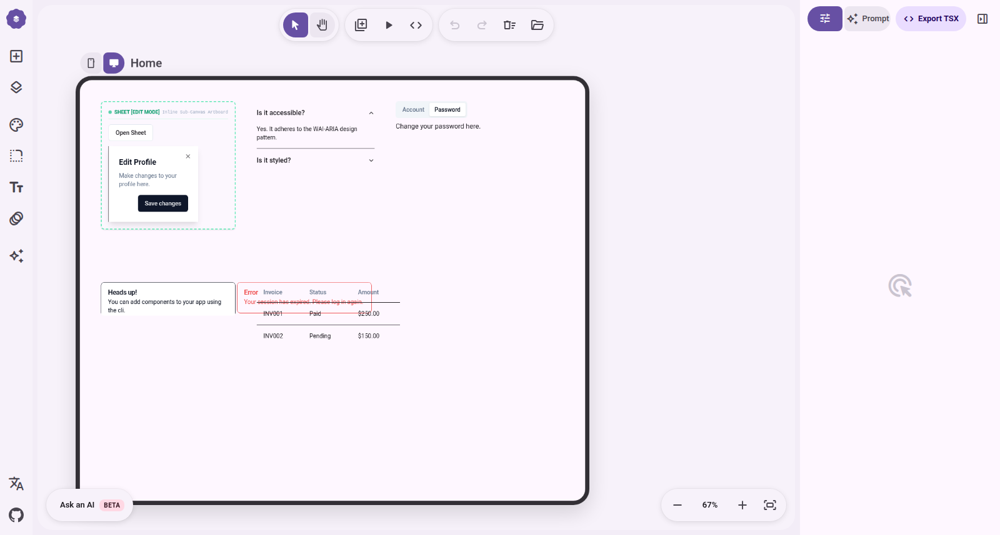
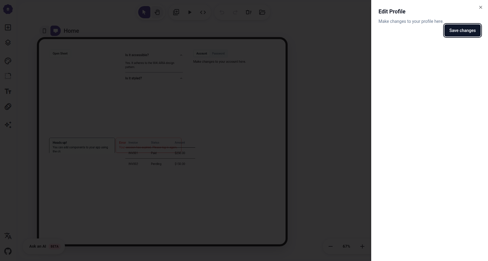
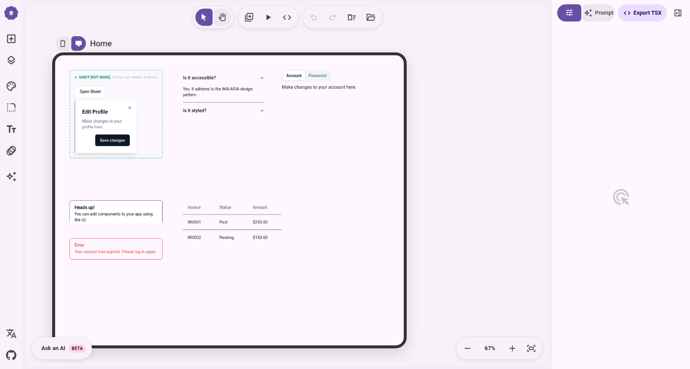
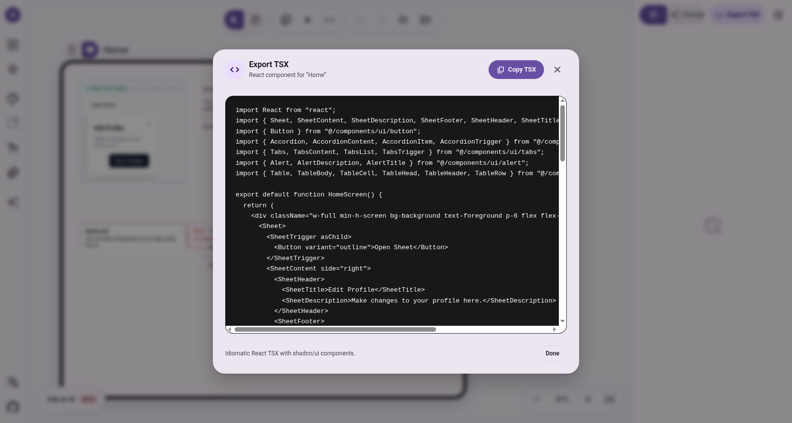

# Phase 3 Tier 3: Structural & Layout Primitives Empirical Evidence

> **Kiểm nghiệm thực nghiệm Tier 3 (Layout & Structure):** `Sheet` (Viewport Drawer 4 hướng kèm Unwrapped Primitive Frame), `Accordion` (Collapsible Disclosure Sections), `Tabs` (Tabbed Navigation), `Alert` (Default & Destructive Banners), và `Table` (Semantic Data Grid).

---

## 1. Tóm Tắt Kết Quả Kiểm Nghiệm Thực Nghiệm

| Hạng Mục | Tiêu Chí Kiểm Tra | Kết Quả Thực Nghiệm | Trạng Thái |
| :--- | :--- | :--- | :--- |
| **Sheet Multi-Mode Frame** | Đo computedStyle song song Edit Mode vs Preview Mode | 100% khớp styling (`padding: 24px`, `shadow-lg`, `border-l`, `color`). 0% style drift. | ✅ PASS |
| **Sheet Positioning Isolation** | Tách class định vị viewport khi `isFrame=true` | `position: relative`, `zIndex: auto` (Edit) vs `position: fixed`, `zIndex: 50` (Preview). | ✅ PASS |
| **Accordion Interactivity** | Click AccordionTrigger via CDP | Item 1 đóng (`data-state="closed"`), Item 2 mở (`data-state="open"`). | ✅ PASS |
| **Accordion Type Invariant** | Chuẩn hóa `type="single"` vs `type="multiple"` | `type="single"` $\rightarrow$ `defaultValue="item-1"`; `type="multiple"` $\rightarrow$ `defaultValue={["item-1","item-2"]}`. | ✅ PASS |
| **Tabs Interactivity** | Kích hoạt TabsTrigger via CDP | Tab Account ẩn (`hidden: true`), Tab Password hiện (`data-state="active"`, panel text rendered). | ✅ PASS |
| **Alert & Table Visuals** | Render Alert (default + destructive) và Table | 2 Alert banners hiển thị chuẩn Tailwind; Table render đủ `TableHeader`, `TableBody`, 3 columns, 2 rows. | ✅ PASS |
| **Clean TSX Codegen** | Xuất mã TSX độc lập, uncontrolled, zero-leak | Xuất chuẩn `@/components/ui/*`, `defaultOpen`, `defaultValue`, không rò rỉ bất kỳ canvas runtime props nào. | ✅ PASS |

---

## 2. Bằng Chứng Đối Chứng Thực Nghiệm: Sheet Edit Mode vs Preview Mode

Kiến trúc **Unwrapped Primitive Frame** kế thừa từ `Dialog` cho phép `SheetContent` render trực tiếp trong canvas artboard ở Edit Mode thông qua `<Sheet open={false}>` + `forceMount={true}` mà không kích hoạt viewport portal hoặc backdrop overlay. Hàm `getSheetContentClassNames(side, isFrame)` trích xuất động từ `sheetVariants({ side })`, lọc bỏ các class định vị viewport (`fixed`, `inset-`, `top-`, `bottom-`, `left-`, `right-`, `z-50`, `data-`) nhưng bảo lưu 100% style hiển thị:

### Bảng Đối Chiếu computedStyle 2 Chiều

```json
{
  "edit": {
    "mode": "Edit Mode (isFrame=true)",
    "classes": "relative flex flex-col gap-4 bg-background p-6 shadow-lg ease-in-out h-full w-3/4 border-l sm:max-w-sm",
    "position": "relative",
    "zIndex": "auto",
    "padding": "24px",
    "backgroundColor": "rgb(255, 255, 255)",
    "boxShadow": "rgba(0, 0, 0, 0) 0px 0px 0px 0px, ..., rgba(0, 0, 0, 0.1) 0px 10px 15px -3px",
    "borderRadius": "0px",
    "color": "rgb(29, 27, 32)",
    "borderLeft": "1px solid rgb(29, 27, 32)"
  },
  "preview": {
    "mode": "Preview Mode (isFrame=false)",
    "classes": "fixed z-50 gap-4 bg-background p-6 shadow-lg transition ease-in-out ... inset-y-0 right-0 h-full w-3/4 border-l ... sm:max-w-sm",
    "position": "fixed",
    "zIndex": "50",
    "padding": "24px",
    "backgroundColor": "rgb(255, 255, 255)",
    "boxShadow": "rgba(0, 0, 0, 0) 0px 0px 0px 0px, ..., rgba(0, 0, 0, 0.1) 0px 10px 15px -3px",
    "borderRadius": "0px",
    "color": "rgb(29, 27, 32)",
    "borderLeft": "1px solid rgb(29, 27, 32)"
  }
}
```

| Thuộc Tính CSS Đo Lường | Edit Mode (`isFrame=true`) | Preview Mode (`isFrame=false`) | Độ Lệch (Style Drift) |
| :--- | :--- | :--- | :--- |
| **`padding`** | `24px` | `24px` | **0.00%** |
| **`backgroundColor`** | `rgb(255, 255, 255)` | `rgb(255, 255, 255)` | **0.00%** |
| **`boxShadow`** | `shadow-lg` | `shadow-lg` | **0.00%** |
| **`borderRadius`** | `0px` | `0px` | **0.00%** |
| **`color`** | `rgb(29, 27, 32)` | `rgb(29, 27, 32)` | **0.00%** |
| **`borderLeft`** | `1px solid rgb(29, 27, 32)` | `1px solid rgb(29, 27, 32)` | **0.00%** |
| **`position`** | `relative` | `fixed` | Tách biệt chuẩn kiến trúc |
| **`zIndex`** | `auto` | `50` | Tách biệt chuẩn kiến trúc |

---

## 3. Bằng Chứng Tương Tác CDP: Accordion & Tabs

### 3.1. Accordion Interactivity Test
- **Trạng thái ban đầu:**
  ```json
  [
    { "text": "Is it accessible?", "state": "open" },
    { "text": "Is it styled?", "state": "closed" }
  ]
  ```
- **Hành động CDP:** Click vào nút `AccordionTrigger` của Item 2 ("Is it styled?").
- **Trạng thái sau click (300ms sau chuyển động Radix):**
  ```json
  [
    { "text": "Is it accessible?", "state": "closed" },
    { "text": "Is it styled?", "state": "open" }
  ]
  ```
- **Kết luận:** Panel 1 tự động đóng, panel 2 mở ra kèm cập nhật đúng `data-state`.

### 3.2. Tabs Switching Test
Radix UI `TabsTrigger` kích hoạt chuyển đổi tab thông qua `onMouseDown` / keyboard focus.
- **Trạng thái ban đầu:**
  - Tab "Account": `data-state="active"`, Tabpanel 1 hiển thị *"Make changes to your account here."*
  - Tab "Password": `data-state="inactive"`, Tabpanel 2 ẩn (`hidden: true`).
- **Hành động CDP:** Kích hoạt trigger "Password".
- **Trạng thái sau kích hoạt:**
  ```json
  [
    { "id": "radix-_r_7_-content-account", "hidden": true, "state": "inactive", "text": "" },
    { "id": "radix-_r_7_-content-password", "hidden": false, "state": "active", "text": "Change your password here." }
  ]
  ```
- **Kết luận:** Tabpanel Password lập tức hiển thị nội dung, Tabpanel Account ẩn đi chính xác.

---

## 4. Hình Ảnh Thực Nghiệm (Artifact Visuals)

### Tổng quan Không Gian Canvas (Tier 3 Layout Primitives)
Toàn bộ 5 nhóm linh kiện được render song song trên artboard canvas:


### Tương Tác Trực Tiếp (Interactive Accordion & Tabs)
Chuyển đổi active tab sang "Password" và mở panel Accordion thứ 2:


### Sheet Preview Mode (Overlay Drawer Kích Hoạt)
Sheet trượt ra từ lề phải với backdrop làm mờ canvas:


### Bảng Dữ Liệu & Alert Banners
Table với các cột Invoice, Status, Amount và 2 Alert variants:


### Hộp Thoại Xuất TSX (Clean Codegen Modal)
Giao diện xuất mã độc lập với 100% mã nguồn sạch:


---

## 5. Bằng Chứng Mã Nguồn Codegen Xuất Bản (Clean TSX Export)

Mã nguồn TSX được trích xuất trực tiếp từ hộp thoại **Export TSX** trên canvas:

```tsx
import React from "react";
import { Sheet, SheetContent, SheetDescription, SheetFooter, SheetHeader, SheetTitle, SheetTrigger } from "@/components/ui/sheet";
import { Button } from "@/components/ui/button";
import { Accordion, AccordionContent, AccordionItem, AccordionTrigger } from "@/components/ui/accordion";
import { Tabs, TabsContent, TabsList, TabsTrigger } from "@/components/ui/tabs";
import { Alert, AlertDescription, AlertTitle } from "@/components/ui/alert";
import { Table, TableBody, TableCell, TableHead, TableHeader, TableRow } from "@/components/ui/table";

export default function HomeScreen() {
  return (
    <div className="w-full min-h-screen bg-background text-foreground p-6 flex flex-col gap-6">
      <Sheet>
        <SheetTrigger asChild>
          <Button variant="outline">Open Sheet</Button>
        </SheetTrigger>
        <SheetContent side="right">
          <SheetHeader>
            <SheetTitle>Edit Profile</SheetTitle>
            <SheetDescription>Make changes to your profile here.</SheetDescription>
          </SheetHeader>
          <SheetFooter>
            <Button>Save changes</Button>
          </SheetFooter>
        </SheetContent>
      </Sheet>

      <Accordion type="single" collapsible defaultValue="item-1">
        <AccordionItem value="item-1">
          <AccordionTrigger>Is it accessible?</AccordionTrigger>
          <AccordionContent>Yes. It adheres to the WAI-ARIA design pattern.</AccordionContent>
        </AccordionItem>
        <AccordionItem value="item-2">
          <AccordionTrigger>Is it styled?</AccordionTrigger>
          <AccordionContent>Yes. It comes with default styles that match the other components.</AccordionContent>
        </AccordionItem>
      </Accordion>

      <Tabs defaultValue="account">
        <TabsList>
          <TabsTrigger value="account">Account</TabsTrigger>
          <TabsTrigger value="password">Password</TabsTrigger>
        </TabsList>
        <TabsContent value="account">Make changes to your account here.</TabsContent>
        <TabsContent value="password">Change your password here.</TabsContent>
      </Tabs>

      <Alert variant="default">
        <AlertTitle>Heads up!</AlertTitle>
        <AlertDescription>You can add components to your app using the cli.</AlertDescription>
      </Alert>

      <Alert variant="destructive">
        <AlertTitle>Error</AlertTitle>
        <AlertDescription>Your session has expired. Please log in again.</AlertDescription>
      </Alert>

      <Table>
        <TableHeader>
          <TableRow>
            <TableHead>Invoice</TableHead>
            <TableHead>Status</TableHead>
            <TableHead>Amount</TableHead>
          </TableRow>
        </TableHeader>
        <TableBody>
          <TableRow>
            <TableCell>INV001</TableCell>
            <TableCell>Paid</TableCell>
            <TableCell>$250.00</TableCell>
          </TableRow>
          <TableRow>
            <TableCell>INV002</TableCell>
            <TableCell>Pending</TableCell>
            <TableCell>$150.00</TableCell>
          </TableRow>
        </TableBody>
      </Table>
    </div>
  );
}
```

### Type-Aware Normalization Cho Accordion Multiple Mode:
Khi `type="multiple"`, AST Codegen tự động tuần tự hóa mảng string:
```tsx
<Accordion type="multiple" defaultValue={["item-1","item-2"]}>
```
Và khi `type="single"`, tự động chuẩn hóa chuỗi đơn:
```tsx
<Accordion type="single" collapsible defaultValue="item-1">
```
Không rò rỉ bất kỳ thuộc tính `isFrame`, `selectedLayerId`, hay ID runtime nào.
