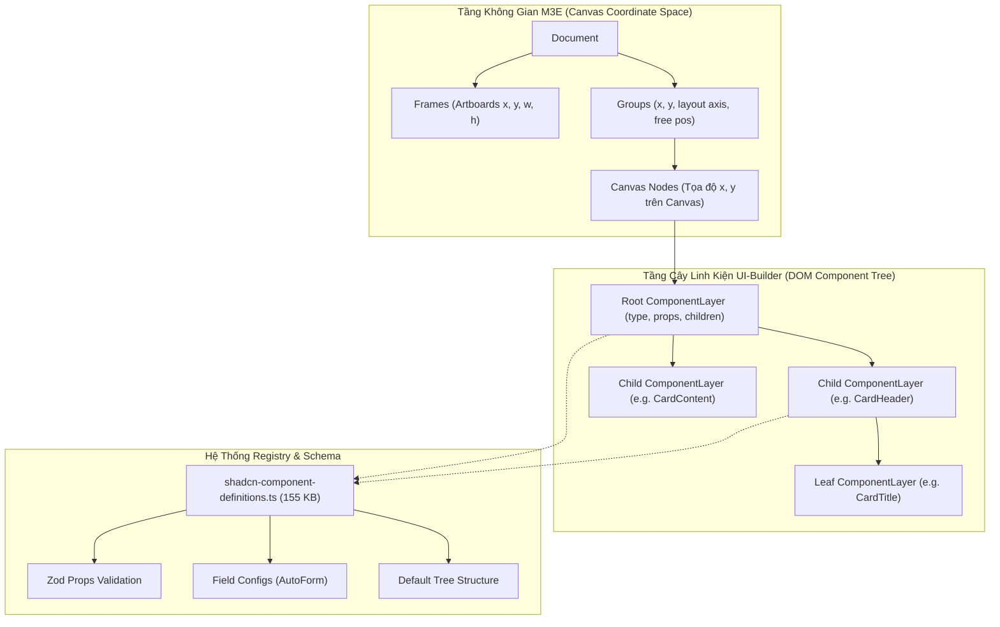

# Design Spec: Phase 2 — Foundation & Hybrid Data Model

- **Dự án:** `shadcn-canvas`
- **Ngày lập:** 2026-09-16
- **Trạng thái:** Sẵn sàng thực thi
- **Mục tiêu:** Xây dựng nền tảng Data Model Hybrid (kết hợp không gian $x, y$ tự do của M3E với schema thuộc tính cây của UI-Builder), tích hợp Component Registry chuẩn, nâng cấp Inspector tự động theo schema, và hoàn thiện AST Codegen cho các cây linh kiện lồng nhau.

---

## 1. Vấn Đề Kiến Trúc Cần Giải Quyết

Trong Phase 1 (POC), chúng ta đã chứng minh:
1. Động cơ Infinite Canvas của M3E kết hợp tốt với Radix UI / Tailwind CSS thông qua `CanvasContext` và Universal Popper Invariant.
2. Tuy nhiên, Data Model của Phase 1 đang dùng cấu trúc phẳng (`Kind` và `ShadcnProps` rời rạc trong `Item`), được nối thủ công bằng tay (hardcoded) cho 3 linh kiện (`shadcnButton`, `shadcnCard`, `shadcnSelect`).

Nếu tiếp tục mở rộng theo cách này cho hơn 40 linh kiện của shadcn:
- Sẽ phải viết hàng nghìn dòng code nối props thủ công trong `Inspector.tsx` và `ShadcnNode.tsx`.
- Không hỗ trợ được các linh kiện có cấu trúc cây lồng nhau (như `Tabs` chứa `TabsList` $\rightarrow$ `TabsTrigger` $\rightarrow$ `TabsContent`, hoặc `Accordion` $\rightarrow$ `AccordionItem` $\rightarrow$ `AccordionTrigger`).
- Không hỗ trợ được chiều dữ liệu `renderMode: 'edit' | 'preview'` cho các Viewport Modals (`Dialog`, `Sheet`).

---

## 2. Kiến Trúc Mô Hình Dữ Liệu Hybrid (Hybrid Data Model)

Hợp nhất hai ưu điểm lớn nhất từ hai dự án mã nguồn mở:
- **`m3e-canvas`:** Hệ tọa độ không gian vô cực ($x, y$), vùng làm việc đa màn hình (`Frame`), công cụ căn chỉnh tự động (Tidy, Align), panning và zooming.
- **`ui-builder`:** Cấu trúc cây lồng nhau (`ComponentLayer`), định nghĩa kiểu dữ liệu Zod Schema, cấu hình form Inspector (`fieldOverrides`), và thư viện metadata phong phú trong `shadcn-component-definitions.ts` (155 KB).



### Chi tiết Interface Dữ liệu Mới:

```typescript
// Định danh một phần tử trên Canvas
export interface CanvasNode {
  id: string;
  frameId?: string;       // Thuộc artboard nào
  x: number;              // Tọa độ x tương đối trong frame hoặc canvas
  y: number;              // Tọa độ y tương đối trong frame hoặc canvas
  w?: number;             // Chiều rộng cố định hoặc auto
  h?: number;             // Chiều cao cố định hoặc auto
  renderMode?: 'edit' | 'preview'; // Cho Dialog/Modal: 'edit' (inline flat) vs 'preview' (modal)
  layer: ComponentLayer;  // Gốc cây component của ui-builder
}
```

---

## 3. Các Thành Phần Trọng Tâm Của Phase 2

### 3.1. Tích Hợp Thư Viện Registry (`lib/registry/`)
- Port `shadcn-component-definitions.ts` từ `reference/ui-builder` sang `lib/registry/`.
- Cung cấp API lookup:
  - `getComponentEntry(type: string): RegistryEntry`
  - `getComponentSchema(type: string): ZodSchema`
  - `createDefaultLayer(type: string): ComponentLayer` (tự động tạo toàn bộ cây mặc định, ví dụ Card sẽ tạo sẵn Header, Title, Content).

### 3.2. Universal Popper Invariant Runtime Provider
- Xây dựng component wrapper chung `PopperZoomAdapter` tự động nhân `zoom` vào mọi props pixel của Floating UI:
  - `sideOffset = (props.sideOffset ?? 4) * zoom`
  - `alignOffset = (props.alignOffset ?? 0) * zoom`
  - `arrowPadding = (props.arrowPadding ?? 4) * zoom`
- Áp dụng triệt để cho `Select`, `Popover`, `Tooltip`.

### 3.3. Multi-Mode Rendering Cho Viewport Modals (`Dialog`)
- **Trong Edit Mode:** Khi `renderMode === 'edit'`, Dialog Content được render inline thành một Artboard Frame phụ trên canvas. Người dùng có thể kéo thả nút, text, input trực tiếp vào trong Dialog.
- **Trong Preview Mode:** Render Dialog bình thường với backdrop phủ toàn màn hình.
- Nút chuyển đổi chế độ Edit/Preview ngay trên Toolbar và Inspector của node Dialog.

### 3.4. Nâng Cấp Inspector Hướng Schema (Schema-Driven Inspector)
- Thay thế việc hardcode từng section props.
- Inspector tự động đọc `schema` và `fieldOverrides` từ Registry để render ra các form control chuẩn:
  - String $\rightarrow$ Input Text / Textarea
  - Enum $\rightarrow$ Select / Segmented Control
  - Boolean $\rightarrow$ Switch / Checkbox
  - Color / Variant $\rightarrow$ Radio Buttons / Select

### 3.5. Nâng Cấp Hierarchical Codegen AST
- `lib/codegen.ts` duyệt đệ quy cây `ComponentLayer`:
  - Sinh JSX chuẩn đẹp với thụt lề đúng chuẩn.
  - Tự động thu thập và khử trùng lặp các lệnh `import { ... } from "@/components/ui/..."`.
  - Giữ vững ranh giới kiến trúc: **Không bao giờ leak bất kỳ thuộc tính nào của `CanvasNode` (`x`, `y`, `renderMode`, `zoom`) vào mã TSX xuất ra.**

---

## 4. Kế Hoạch Nghiệm Thu (Exit Criteria Cho Phase 2)

1. **EC1 (Hybrid Data Model):** Canvas render và di chuyển được cả Component đơn (Button) và Component dạng cây phức tạp (Card với Header/Content/Button lồng nhau).
2. **EC2 (Schema-Driven Inspector):** Đổi variant, text, boolean của bất kỳ component nào trong cây thông qua form tự động sinh từ Zod schema.
3. **EC3 (Dialog Multi-Mode):** Dialog hiển thị dạng khung inline phẳng để thiết kế trên canvas ở Edit Mode, và bung modal toàn màn hình ở Preview Mode.
4. **EC4 (Recursive Codegen):** Xuất mã nguồn React TSX hoàn chỉnh cho toàn bộ cây phân cấp, chạy được độc lập bên ngoài.
