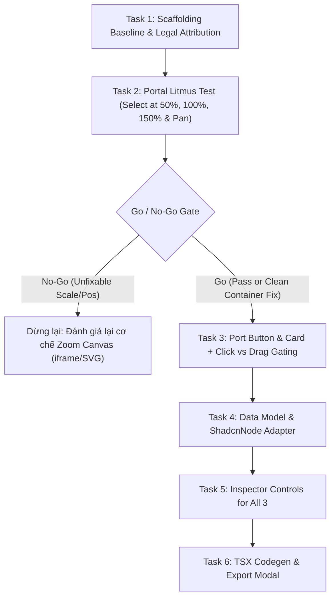

# Design Spec: shadcn-canvas Phase 1 (POC - Litmus Test First)

**Date:** 2026-09-16  
**Status:** Approved & Prioritized (Fail-Fast)  
**Strategy:** Portal Litmus Test first (Task 2) before investing in Button/Card

---

## 1. Core Technical Risk: Portal Positioning & Scaling under Canvas Transform

In `m3e-canvas`, canvas viewport transform is applied on an outer container:
```tsx
transform: `translate(${view.x}px, ${view.y}px) scale(${view.z})`,
transformOrigin: "0 0",
```

Radix UI components using Floating UI / Popper (`Select`, `Popover`, `Dialog`) default to mounting via `createPortal` to `document.body`. Under this CSS transform, two distinct failure modes occur:
1. **Lệch tọa độ định vị (Position Misalignment):** `getBoundingClientRect()` inside a scaled coordinate system can cause Floating UI to miscalculate trigger offsets when `view.z !== 1.0` or when panned.
2. **Lệch tỷ lệ kích thước (Visual Scale Mismatch):** If a dropdown mounts to `document.body`, its font sizes, padding, and dimensions remain at 100% scale while the canvas shrinks to 50% or expands to 150%. The dropdown must scale synchronously with the canvas camera.

### Two Independent Exit Criteria for Portal Test:
- **Tiêu chí (a) - Tọa độ định vị:** Dropdown dính sát mép trigger, không bị lệch x/y dù ở zoom 50%, 100%, 150% hay sau khi pan.
- **Tiêu chí (b) - Tỷ lệ hiển thị:** Toàn bộ nội dung dropdown (font size, padding, border) co giãn đồng bộ đúng tỷ lệ của canvas (`scale(view.z)`).

---

## 2. Fail-Fast Order & Early Go / No-Go Gate

The task sequence is reordered so the highest-risk experiment runs **immediately after scaffolding**:



### Decision Matrix at Task 2:
- **GO:** Select dropdown mounts cleanly inside canvas container, positioning and visual scale match zoom levels. Proceed to Task 3.
- **NO-GO:** Dropdown cannot be correctly positioned or scaled within the transformed canvas container. **STOP immediately**. Re-evaluate canvas architecture before writing any adapter or data model code.

---

## 3. Hybrid Execution Plan

- **Task 1 & Task 2:** **Inline Execution** (Trực tiếp quan sát trực quan hiện tượng lệch pixel, lệch scale trên trình duyệt ở 50%, 100%, 150% zoom).
- **Task 3 ➔ Task 6:** **Subagent-Driven** (Giao subagent thực thi tuần tự các tác vụ cơ học: styling, props wiring, codegen string templates).
